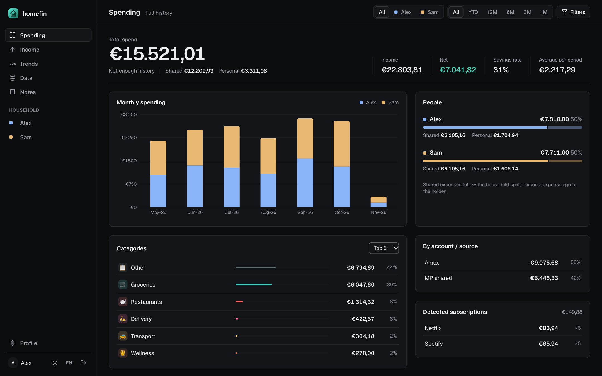
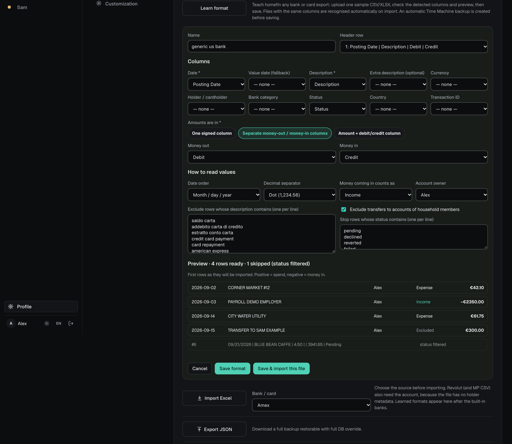
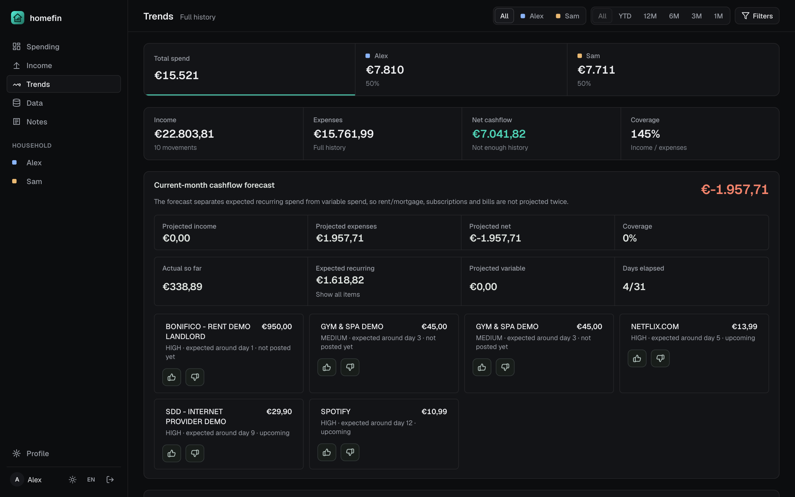
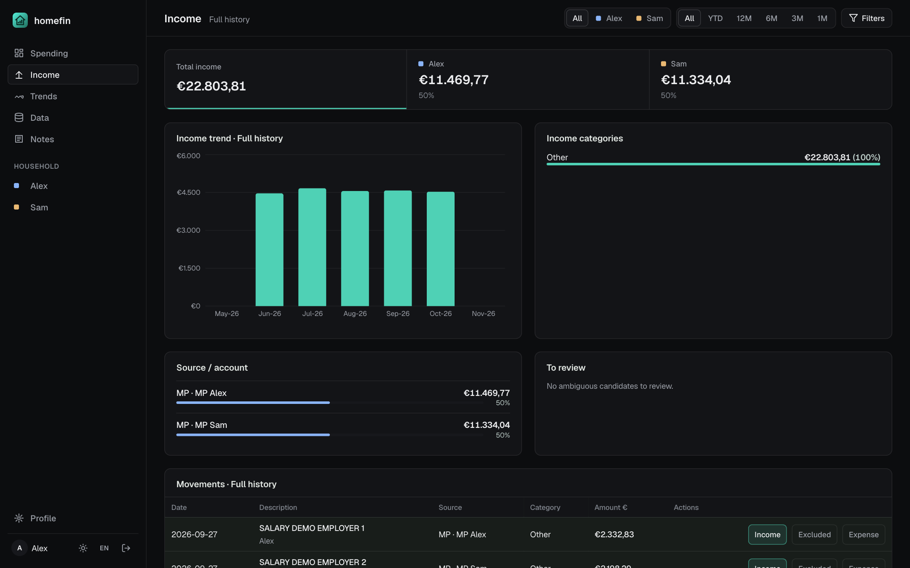
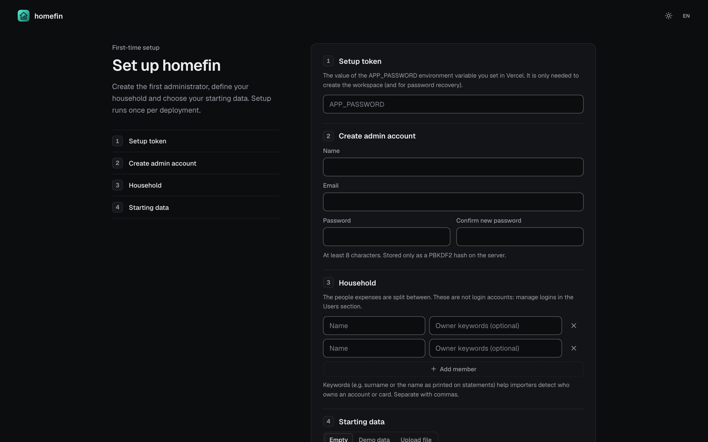
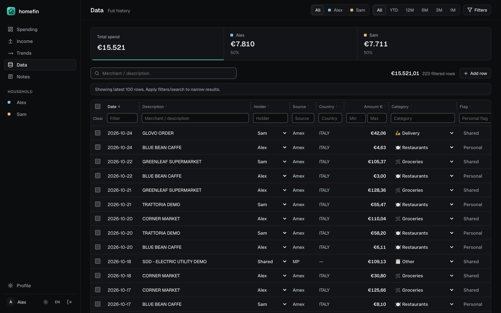
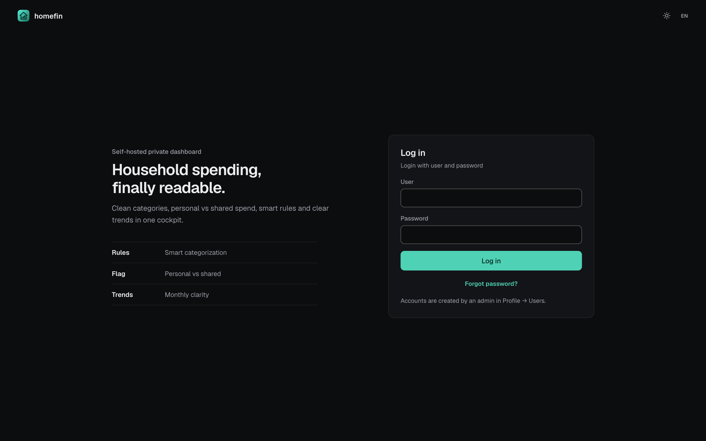
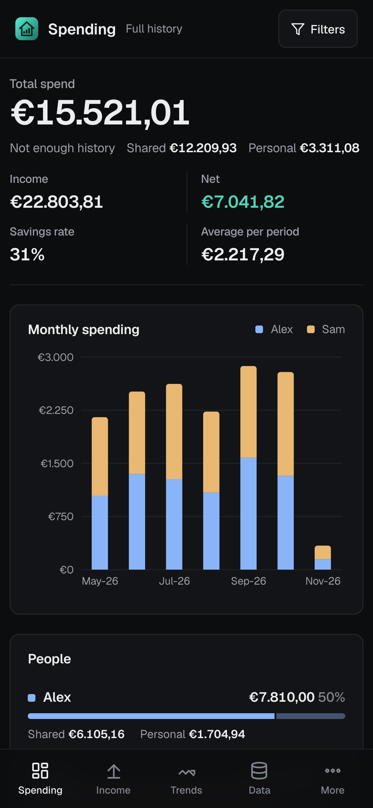
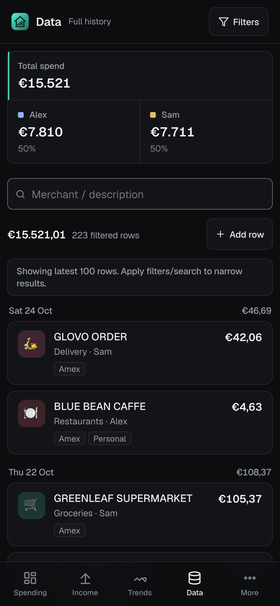
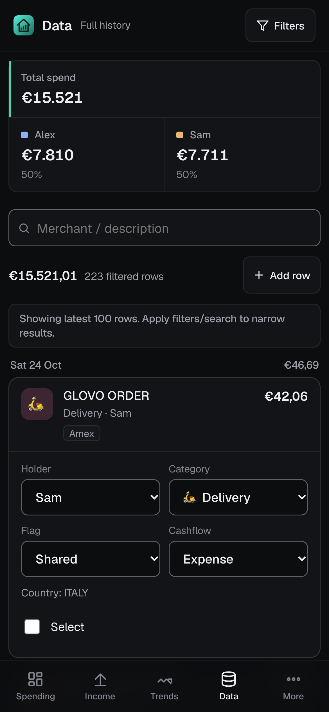

<div align="center">


# homefin

**Your household's money, finally readable.**

Self-hosted finance dashboard for couples, families and flatmates.<br/>
Import statements from **any bank or card**, split shared costs fairly, track income and cash flow — on your own Vercel + KV.

[](LICENSE)


[](https://vercel.com/new/clone?repository-url=https%3A%2F%2Fgithub.com%2Fzappaontheweb%2Fhomefin&project-name=homefin&repository-name=homefin&env=APP_PASSWORD&envDescription=Secret%20setup%20token%20asked%20once%20by%20the%20first-run%20wizard&envLink=https%3A%2F%2Fgithub.com%2Fzappaontheweb%2Fhomefin%235-environment-variables)



</div>

## Why homefin

Most finance apps are built for one person and one bank. Real households share a rent, split groceries, keep a couple of personal cards and use whatever bank each person likes. homefin is built for that:

| | |
| --- | --- |
| 🧠 **Learn any bank format** | Upload one sample export (CSV/XLSX, any language) — homefin detects the header, columns, date order, decimal style and sign convention, shows a live preview, and recognises matching files automatically from then on. |
| 👥 **Fair household split** | Any number of members. Every row is *personal* or *shared*; shared costs are split equally or by your own percentages. |
| 💸 **Expenses, income, cash flow** | Every movement is an expense, income or excluded (transfers between your own accounts, card settlements, investments). Net cash flow and a recurring-aware forecast for the current month. |
| 🏷️ **Rules that learn** | "Description contains X → category / flag". Repeated manual fixes turn into rule suggestions; income decisions are remembered for similar rows. |
| 🕰️ **Time Machine** | Up to 5 full snapshots in your KV store, restorable in one click. One is taken automatically before learning a new format. |
| 🔐 **Private by design** | Your data lives in *your* Vercel KV. PBKDF2-hashed passwords, bearer sessions, setup locked behind a secret token, no third-party analytics. |

<table>
  <tr>
    <td width="50%"><br/><sub><b>Learn format</b> — detected columns, reading rules and a live preview of every row.</sub></td>
    <td width="50%"><br/><sub><b>Trends</b> — income vs expenses, net cash flow and a current-month forecast you can teach with 👍 / 👎.</sub></td>
  </tr>
  <tr>
    <td width="50%"><br/><sub><b>Income</b> — by member, category and source, with a review list for ambiguous transfers.</sub></td>
    <td width="50%"><br/><sub><b>Setup</b> — one wizard: setup token, admin, household members, starting data.</sub></td>
  </tr>
  <tr>
    <td width="50%"><br/><sub><b>Data</b> — every transaction, editable inline; drag a column edge to resize it.</sub></td>
    <td width="50%"><br/><sub><b>Login</b> — with a <i>Forgot password?</i> reset that uses the setup token.</sub></td>
  </tr>
</table>

**On mobile**

<table>
  <tr>
    <td width="33%"><br/><sub><b>Spending</b> — totals, split and monthly chart.</sub></td>
    <td width="33%"><br/><sub><b>Data</b> — one card per transaction, grouped by day.</sub></td>
    <td width="33%"><br/><sub><b>Edit</b> — tap a card to change holder, category, flag or cash flow.</sub></td>
  </tr>
</table>

<sub>Screenshots use the built-in fictional demo data.</sub>

## Quick start

**Deploy:** click **Deploy with Vercel** above, set `APP_PASSWORD` to a long random secret, connect a KV (Upstash Redis) store under **Storage**, redeploy, then open your URL and follow the setup wizard. Step-by-step instructions are below.

**Try it locally first** (no account needed — an in-memory database is used):

```bash
git clone https://github.com/zappaontheweb/homefin.git
```

```bash
cd homefin && npm install && echo "APP_PASSWORD=local-test" > .env.local
```

```bash
npm run dev
```

Open the printed URL, enter `local-test` as the setup token and pick **Demo data**.

## What's inside

- **Any bank or card:** teach homefin a new export format once with **Learn format** (CSV/XLSX, any column layout, language, date and number style); matching files are then recognised automatically.
- **Built-in importers:** American Express and Revolut. Other banks supported: Mediobanca Premier, Fineco.
- **One household per deployment:** every deployment stores one workspace under a single KV key; configurable members, owner keywords and equal/custom shared split.
- **Expenses, income and cash flow:** every row is an *expense*, *income* or *excluded*; income has its own tab, Trends shows net cash flow and a current-month forecast.
- **Time Machine:** keep up to 5 full snapshots in KV and restore any of them in one click.
- **Private by default:** passwords hashed with PBKDF2 (Web Crypto) on the server, bearer sessions, first-run setup protected by a secret token, cross-origin access off unless you opt in.

---

## Self-hosting guide

### Contents

1. [Prerequisites](#1-prerequisites)
2. [Fork the repository](#2-fork-the-repository)
3. [Deploy to Vercel](#3-deploy-to-vercel)
4. [Create and connect a KV store](#4-create-and-connect-a-kv-store)
5. [Environment variables](#5-environment-variables)
6. [First-run setup](#6-first-run-setup)
7. [Importing statements](#7-importing-statements) — including [any other bank or card](#any-other-bank-or-card--learn-format)
8. [Everyday use](#8-everyday-use)
9. [Local development](#9-local-development)
10. [Troubleshooting](#10-troubleshooting)
11. [Security model](#11-security-model)
12. [Project layout](#12-project-layout)

---

## 1. Prerequisites

- A **GitHub** account (to fork the repo).
- A **Vercel** account (the free Hobby plan is enough).
- A **KV store** connected to the Vercel project. New Vercel projects get Redis through the **Upstash** integration in the Vercel Marketplace; it exposes the `KV_REST_API_URL` / `KV_REST_API_TOKEN` variables this app uses.
- For local development only: **Node.js 18+** (20 or 22 recommended) and npm.

## 2. Fork the repository

1. Open the repository on GitHub and click **Fork**.
2. Keep the fork private if you prefer — nothing in the code needs it to be public.

## 3. Deploy to Vercel

1. In Vercel, click **Add New… → Project** and import your fork.
2. Vercel detects **Vite** automatically (`vercel.json` also sets it). Leave the defaults:
   - Build command: `npm run build`
   - Output directory: `dist`
3. **Don't deploy yet** — or let the first deploy fail harmlessly. You need the KV store and `APP_PASSWORD` first (steps 4–5), then redeploy.

The API is a single Vercel **Edge Function** at `api/data.js`; there is no other server.

## 4. Create and connect a KV store

1. In the Vercel project, open the **Storage** tab.
2. Choose **Create Database** and pick the **Upstash for Redis** (KV) option from the Marketplace. Any region close to you is fine.
3. Connect it to this project for the **Production** (and, if you use them, **Preview**) environments.
4. Vercel injects `KV_REST_API_URL`, `KV_REST_API_TOKEN` (and a few read-only variants) into the project automatically. Check them under **Settings → Environment Variables**.

> One KV store per deployment. If you run several households, deploy the project several times, each with its own KV store (or a different `HOMEFIN_KV_KEY`).

## 5. Environment variables

Set these in **Settings → Environment Variables**, then **redeploy** (Deployments → ⋯ → Redeploy) so the function picks them up. See `.env.example` for the same list.

| Variable | Required | Purpose |
| --- | --- | --- |
| `APP_PASSWORD` | **Yes** | Setup token. The first-run wizard asks for it once to create the workspace; it also authorizes emergency password resets. It is **not** a login password. Use a long random value, e.g. `openssl rand -base64 24`. |
| `KV_REST_API_URL` | **Yes** | KV REST endpoint. Added automatically when you connect the store. |
| `KV_REST_API_TOKEN` | **Yes** | KV REST token. Added automatically when you connect the store. |
| `HOMEFIN_KV_KEY` | No | KV key holding the whole workspace. Default `homefin:data`. |
| `ALLOWED_ORIGINS` | No | Comma-separated origins allowed to call `/api/data` cross-origin. Leave empty: the bundled app is same-origin. |

## 6. First-run setup

Open your deployment URL. While the workspace has no users, the app shows the **setup wizard**:

1. **Setup token** — paste the value of `APP_PASSWORD`.
2. **Admin account** — your display name (also your username, lower-cased with `_` for spaces), optional email, and a password of at least 8 characters.
3. **Household** — add one row per person who shares expenses:
   - **Name** as you want it shown in the dashboard.
   - **Owner keywords** *(optional, comma-separated)* — how the person appears on statements, e.g. a surname or `ROSSI MARIO`. Importers use names and keywords to work out who owns a card or bank account, and to recognise transfers between your own accounts.
   - **Shared expense split** (with 2+ members): *Equal split* or *Custom percentages* (must total 100%).
4. **Starting data**
   - **Empty** — start with no transactions.
   - **Demo data** — six months of fictional transactions generated for the members you entered. Good for a first look.
   - **Upload file** — an Amex `.xlsx` statement or a homefin JSON backup.
5. Click **Create workspace**. You're signed in as admin.

Once setup has completed, the bootstrap endpoint refuses further calls, so nobody can re-run it on a live workspace.

**Adding other people:** go to **Profile → Users → Add user**, choose a role, and share the generated username/password with them. Household members and login users are independent: a member doesn't need a login, and an admin login doesn't need to be a member.

**Changing the household later:** **Profile → Household** (admins only). Totals and charts are recomputed immediately; past transactions are re-matched against the new names and keywords.

## 7. Importing statements

Go to **Profile → Data & Import**, pick the **Bank / card**, then **Import Excel** and select one or more files. Imports are idempotent: rows already present (same reference/date/amount/description) are skipped, so re-importing an overlapping period is safe. After each import your categorization rules are applied.

Fictional sample files for every format are in [`samples/`](samples/) — import them into a demo workspace to see what each importer does. Regenerate with `npm run samples` and verify parsing with `npm run check:samples`.

### American Express — `.xlsx`

- Export: Amex website → *Statements & activity* → download the spending summary as **Excel** (the importer reads the Italian-language Amex export).
- Expected columns: *Date, Description, Cardholder, Amount, Reference, Country*; title rows above the table may carry the statement period.
- Owner: taken from the **Cardholder** column and matched to household members by name/keywords.
- Periods: Amex statements run from the 21st to the 20th; the dashboard can show either **Amex periods** or **calendar months**. Day/month swaps from Excel are auto-corrected using the statement period.
- Excluded automatically: the card-settlement rows that pay off the statement balance.

### Revolut — `.csv`

- Export: Revolut app → account → *Statement* → **CSV**. Export one file per account.
- Revolut CSVs contain no owner information, so choose the **Revolut account** (one per member, plus *Shared* when you have 2+ members) before importing.
- Only completed rows are imported. Foreign-currency rows are converted to EUR with daily ECB rates from the public Frankfurter API.
- Excluded automatically: top-ups/deposits, transfers (including pockets), currency exchanges, interest.

### Other banks supported

Mediobanca Premier, Fineco.

### Any other bank or card — Learn format

homefin is not limited to the banks above. Train it once on any provider's export and it imports that format from then on:

1. **Profile → Data & Import → Learn format** (admins) and pick one sample export (`.csv`, `.txt`, `.tsv`, `.xlsx`, `.xls`).
2. homefin detects, and lets you correct:
   - **Sheet** and **header row** — title or account-info rows above the table are skipped automatically.
   - **Columns** — date (plus an optional value-date fallback), description (plus an optional second description column that gets appended), and optional currency, holder/cardholder, bank category, status, country and transaction ID.
   - **Amounts** — one signed column, separate money-out / money-in columns, or an amount plus a debit/credit indicator column (e.g. `DR`/`CR`, `D`/`C`, `Debit`/`Credit`).
   - **Reading rules** — date order (day/month vs month/day; ISO, `20260901`, Excel dates and month names in English, Italian, German, French and Spanish are always understood), decimal separator, whether money out is shown as negative (bank accounts) or positive (credit cards), and whether money coming in counts as **income**, a **refund** (reduces spending) or is **ignored**. Incoming rows that look like refunds (the word *refund* in several languages) always count as refunds.
   - **Owner** — a household member, *Shared*, or per row from the holder column (matched against member names and keywords).
   - **Exclusions** — description keywords to exclude (card settlements, transfers between your own accounts, investments; pre-filled, editable), an option to exclude transfers to accounts of household members, and status values to skip (pending, declined, reverted…).
3. The **live preview** shows exactly how the first rows will be imported (date, description, owner, Expense/Income/Refund/Excluded, amount) and why any row would be skipped.
4. **Save format**, or **Save & import this file**. A Time Machine backup is created first.

From then on the format appears in the **Bank / card** list, and any file whose header row matches it is recognised automatically — even if another bank is selected. Each row gets a stable reference (the provider's transaction ID when mapped, otherwise date + amount + description + an occurrence counter), so overlapping exports never create duplicates. Foreign-currency rows are converted to EUR with daily ECB rates (Frankfurter API). Saved formats can be edited or deleted from the same panel; deleting a format keeps the transactions already imported.

### Backups

- **Export JSON** downloads the full workspace (transactions, rules, categories, notes, household) **without** user accounts.
- **Import Backup** (admins only) replaces the workspace data with a backup. User accounts and passwords on the server are kept as they are.

## 8. Everyday use

- **Expense / Trends** — totals per member with personal/shared breakdown, category mix, account/source breakdown, income vs expenses vs net cash flow, and a recurring-aware forecast for the current month (thumbs up/down on forecast items teaches it what to expect).
- **Income** — income by member, category and source, plus a review list of ambiguous incoming transfers; marking a row Income / Not income teaches homefin to classify similar rows the same way.
- **Time Machine** (Profile → Data) — up to 5 named full snapshots stored in KV; download or restore (admins) at any time. Snapshots never include user accounts.
- **Data** — the transaction table. Edit holder, category, personal/shared flag and cash-flow type (Expense / Income / Excluded) per row, or select rows for bulk edits. Admins can add manual rows and delete rows. On desktop, drag a column edge to resize it (double-click resets it; widths are remembered per browser). On mobile each transaction is a card with its category icon, source and tags; tap it to edit.
- **Rules** (Profile → Rules & Logic) — "description contains X → category Y / personal or shared". Repeated manual edits become rule suggestions.
- **Notes** — monthly notes per member next to their personal spend.

How amounts are counted and split is documented in [docs/how-it-works.md](docs/how-it-works.md).

## 9. Local development

```bash
npm install
```

```bash
cp .env.example .env.local
```

Set `APP_PASSWORD` in `.env.local` (any value for local use), then:

```bash
npm run dev
```

With no `KV_REST_API_URL`/`KV_REST_API_TOKEN` in `.env.local`, the dev server serves `/api/data` itself backed by an **in-memory KV** (`dev/kv-memory.js`), so the full setup → import → login flow works offline. Data is lost when the dev server restarts. To develop against a real store, put the KV credentials in `.env.local` (Vercel CLI: `vercel env pull .env.local`).

Other scripts:

| Script | What it does |
| --- | --- |
| `npm run build` | Production build into `dist/` |
| `npm run preview` | Serve the built frontend (no API) |
| `npm run samples` | Regenerate the fictional files in `samples/` |
| `npm run check:samples` | Parse every sample with the real importers, including Learn format detection, and check the totals |

## 10. Troubleshooting

**The wizard says "APP_PASSWORD is not configured on the server".**
Add `APP_PASSWORD` in Vercel → Settings → Environment Variables and redeploy. Environment changes only apply to new deployments.

**"Invalid setup token".**
The value must match `APP_PASSWORD` exactly (watch for trailing spaces). Check which environment (Production/Preview) you set it for.

**"Setup already completed" but I can't log in.**
The workspace already has users. Log in with the admin account, or reset a password (next item).

**I forgot my password.**
On the login screen, click **Forgot password?**, then enter your username, the setup token (`APP_PASSWORD`) and a new password. Or do the same from the command line:

```bash
curl -X POST "https://YOUR-APP.vercel.app/api/data?action=recover" -H "X-Homefin-Setup-Token: YOUR_APP_PASSWORD" -H "Content-Type: application/json" -d '{"username":"your_username","newPassword":"a-new-long-password"}'
```

The username is your display name lower-cased with spaces as `_` (shown in Profile → Username).

**"Too many failed attempts".**
After 10 failed logins from the same IP, login is blocked for 15 minutes.

**API calls return 500 / the app is stuck on "Loading".**
Usually the KV store isn't connected to the environment you're using. Open the function logs (Vercel → Deployments → the deployment → Functions) and confirm `KV_REST_API_URL` and `KV_REST_API_TOKEN` exist for that environment.

**An import says the format isn't recognised.**
Make sure you picked the matching **Bank / card** first, and that the file is the bank's original export (not re-saved with different headers). Compare with the file in `samples/`.

**Transactions are assigned to the wrong person.**
Add owner keywords in Profile → Household matching how names appear on that statement, then fix individual rows in the Data tab (holder column) or with bulk edit. **Data Health** shows how many holders don't match any member.

**Revolut or learned-format import fails with an FX error.**
Foreign-currency rows need the public Frankfurter API; retry later or import EUR-only statements. Amounts are always shown in EUR.

**A learned format imports wrong signs, dates or owners.**
Open Profile → Data → Learn format → *Edit* on the saved format and adjust *Money out is shown as*, *Date order*, *Decimal separator* or *Account owner*. To re-detect columns, upload a new sample and save it with the same name. Fix already-imported rows from the Data tab (bulk edit) or restore the automatic Time Machine backup taken before the import.

**A file is not recognised automatically.**
Recognition compares the header row with the saved format. If your bank renamed or added columns, learn the format again from a new sample.

**I want to start over.**
Delete the `homefin:data` key (or your `HOMEFIN_KV_KEY`) and `homefin:time-machine` in the KV store's data browser in Vercel/Upstash. The next visit shows the setup wizard again. Sessions expire on their own after 30 days.

## 11. Security model

- **Passwords** are hashed server-side with PBKDF2-SHA-256 (100,000 iterations, random salt). Hashes never leave the server; API responses strip them.
- **Login** sends credentials once in an `Authorization: Basic` header (never the URL). The server returns a random session token stored hashed in KV with a 30-day TTL; later requests use `Authorization: Bearer`.
- **Bootstrap** requires `APP_PASSWORD` in the `X-Homefin-Setup-Token` header and only works while no users exist.
- **Roles:** only admins can add/delete users, change roles, set other users' passwords, edit the household, learn import formats, restore a full backup or restore/delete Time Machine snapshots. Standard users can edit their own profile and password.
- **CORS:** off by default; enable specific origins with `ALLOWED_ORIGINS`.
- **Rate limiting:** 10 failed logins per IP per 15 minutes.
- Always use the HTTPS URL Vercel gives you.

## 12. Project layout

```
api/data.js                 Edge Function: auth, sessions, setup, data read/write (Vercel KV)
src/App.jsx                 The single-page app (dashboard, setup wizard, settings)
src/importers/              Amex, Revolut, MP and Fineco parsers, the generic "Learn format" engine (customImporter.js) and household owner matching
src/LearnFormatPanel.jsx    The Learn format UI
src/demoData.js             Fictional demo-data generator used by the setup wizard
src/styles/homefin.css      Styles
dev/kv-memory.js            In-memory KV used by `npm run dev` without credentials
samples/                    Fictional statements in every supported format
scripts/                    Sample generator and importer check
docs/how-it-works.md        Cash-flow, income and allocation rules
```

## License

[MIT](LICENSE)
